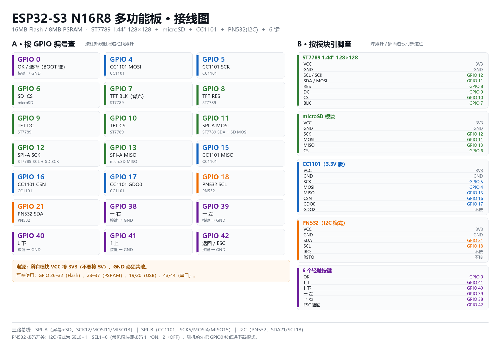

# ESP32-S3 N16R8 → 类 Flipper Zero 多功能板：接线与刷机手册

> 目标板：ESP32-S3 **N16R8**（16 MB Flash + 8 MB PSRAM）
> 固件：**Bruce**（开源，AGPL-3.0，<https://github.com/BruceDevices/firmware>）
> 外设：ST7789 1.44″ 128×128、microSD、CC1101、PN532（I2C）、6 个按键

---

## 0. 先把一件事说明白

**Flipper Zero 的官方固件刷不进 ESP32。** 它的主控是 STM32WB55（ARM Cortex-M4），和 ESP32-S3 是两套完全不同的架构，不存在"移植固件"这回事。

能做到"功能类似"的，是另一批用 ESP32 重写的开源项目。你给的这套模块（CC1101 + PN532 + ST7789 + SD）里，**Bruce 是支持度最高的一个**：官方功能表里 CC1101 和 PN532 都是原生支持项，而且它的官方 RF Reaper 开发板用的就是 ESP32-S3 + 16MB/8MB，硬件形态和你的几乎一致。

所以本方案 = **Bruce + 为你这块板子新写的板级配置**。不是刷一个现成 bin，而是按你的引脚重新编译一份。

---

## 1. 硬件清单

| 模块 | 建议型号 | 关键点 |
|---|---|---|
| 主控 | ESP32-S3-DevKitC-1 **N16R8** | 16MB Flash / 8MB OPI PSRAM |
| 屏幕 | ST7789 1.44″ 128×128 SPI | 8 针：VCC/GND/SCL/SDA/RES/DC/CS/BLK |
| 存储 | microSD 卡模块（SPI） | 卡格式化成 **FAT32**，≤32GB |
|  Sub-GHz | CC1101 模块 | **必须 3.3V 版**，带天线 |
| NFC/RFID | PN532（红板 V3） | 走 **I2C**，拨码 1→ON、2→OFF |
| 按键 | 6× 6×6 轻触开关 | 一端接 GPIO，一端接 GND |

> **供电警告**：CC1101、PN532、ST7789、SD 全部是 3.3V 器件。**VCC 一律接 3V3，不要接 5V**，5V 会烧 CC1101 和 PN532 的逻辑。所有模块必须**共地**。

---

## 2. 接线



### 2.1 三路总线

| 总线 | 用途 | 引脚 |
|---|---|---|
| SPI-A | ST7789 + microSD 共用 | SCK=**12**，MOSI=**11**，MISO=**13** |
| SPI-B | CC1101 独占 | SCK=**5**，MOSI=**4**，MISO=**15** |
| I2C | PN532 | SDA=**21**，SCL=**18** |

屏幕和 SD 共用一组 SPI，靠各自的 CS 分时占用；CC1101 单独一路，避免和屏幕抢总线导致射频收发不稳。

### 2.2 逐针接线

**ST7789 1.44″**

| 模块引脚 | 接到 |
|---|---|
| VCC | 3V3 |
| GND | GND |
| SCL / SCK | GPIO 12 |
| SDA / MOSI | GPIO 11 |
| RES | GPIO 8 |
| DC | GPIO 9 |
| CS | GPIO 10 |
| BLK | GPIO 7 |

**microSD 模块**

| 模块引脚 | 接到 |
|---|---|
| VCC | 3V3 |
| GND | GND |
| SCK | GPIO 12 |
| MOSI | GPIO 11 |
| MISO | GPIO 13 |
| CS | GPIO 6 |

**CC1101**

| 模块引脚 | 接到 |
|---|---|
| VCC | 3V3 |
| GND | GND |
| SCK | GPIO 5 |
| MOSI | GPIO 4 |
| MISO | GPIO 15 |
| CSN | GPIO 16 |
| GDO0 | GPIO 17 |
| GDO2 | 不接 |

**PN532（I2C 模式）**

| 模块引脚 | 接到 |
|---|---|
| VCC | 3V3 |
| GND | GND |
| SDA | GPIO 21 |
| SCL | GPIO 18 |
| IRQ | 不接 |
| RSTO | 不接 |

**按键**（每个按键一端接 GPIO，另一端接 GND；固件内部已开上拉）

| 功能 | GPIO |
|---|---|
| OK / 选择 | 0（可直接用板载 BOOT 键） |
| ↑ 上 | 41 |
| ↓ 下 | 40 |
| ← 左 | 39 |
| → 右 | 38 |
| 返回 / ESC | 42 |

### 2.3 为什么是这些引脚

ESP32-S3 N16R8 有一批引脚被内部占用，接上去必然出问题：

| 引脚 | 占用原因 |
|---|---|
| GPIO 26–32 | SPI Flash |
| GPIO 33–37 | 八线 PSRAM（R8 特有） |
| GPIO 19 / 20 | 原生 USB D− / D+ |
| GPIO 43 / 44 | UART0（留给串口日志） |
| **GPIO 48** | **DevKitC-1 板载 RGB 灯**，所以 I2C 没用它 |
| GPIO 0 / 45 / 46 | 启动 strapping（0 用作按键是安全的，只是按住上电会进下载模式） |

---

## 3. 刷机

> ✅ **这一步已经替你做完了。** 固件已编译并烧录到 COM8，esptool 校验通过（`Hash of data verified`）。
>
> - 合并镜像：`F:\esp32-build\firmware-main\Bruce-s3-n16r8-multitool.bin`（3,769,568 字节）
> - 占用：3.7 MB / 16 MB（22.1%）
>
> ⚠️ **烧完必须按一下板上的 RST 键（或拔插一次 USB）才会跑应用。**
> ESP32-S3 走原生 USB 复位时会强制进入下载模式，串口会停在
> `boot:0x0 (DOWNLOAD(USB/UART0))` + `waiting for download`，这是正常现象，不是烧录失败。

### 方式 A：PlatformIO 直接烧

```powershell
cd F:\esp32-build\firmware-main
$env:PATH = "F:\pio-core\bin;$env:PATH"
$env:PLATFORMIO_CORE_DIR = 'F:\pio-core'
python -m platformio run -e s3-n16r8-multitool -t upload --upload-port COM8
```

### 方式 B：用 esptool 烧合并镜像（本次用的就是这条）

```powershell
python -m esptool --chip esp32s3 --port COM8 --baud 921600 `
  write-flash 0x0 "Bruce-s3-n16r8-multitool.bin"
```

合并镜像已经把 bootloader（0x0）、分区表（0x8000）、应用（0x10000）打包在一起，只需要烧 0x0 一个地址。

### 进下载模式

正常情况下 esptool 会自动复位。如果连不上：**按住 BOOT（GPIO0）不放 → 点一下 RST → 松开 BOOT**。

---

## 4. 第一次开机

1. 屏幕亮起后进 `Config`：
   - **RF Module** 选 `CC1101`
   - **RFID Module** 选 `PN532 I2C`
   - 调亮度、屏幕方向
2. 插卡后进 `Files` 确认 SD 挂载成功。
3. 进 `RF` → `Config` 确认频段（433/315/868 MHz），再试 `Scan`。

---

## 5. 这套硬件能做什么、不能做什么

**能用**：Sub-GHz 收发/频谱/重放（CC1101）、NFC/RFID 读卡写卡（PN532）、BadUSB（S3 原生 USB）、WiFi/BLE 相关功能、SD 文件管理、JS 脚本解释器。

**受限**：
- **PN532 的卡模拟很弱**——只支持 NDEF 和 ISO14443-4，不像 Flipper 那样能模拟大部分卡。想要完整模拟得换 ST25R3916。
- 1.44″ / 128×128 的屏幕能跑，但字很小、一屏信息少，属于"能用不舒适"。
- 没有红外收发、没有 iButton、没有 NRF24（这些需要额外模块；固件的 IR/RF 单针模块引脚我留了 GPIO 1/2/18 可选）。

---

## 6. 常见问题

| 现象 | 处理 |
|---|---|
| 白屏 / 花屏 / 闪 | 杜邦线太长，把 `pins_arduino.h` 里 `SPI_FREQUENCY` 从 27000000 降到 20000000 |
| 颜色红蓝反了 | `TFT_RGB_ORDER` 从 `0` 改成 `1` |
| 画面反色 | 加 `#define TFT_INVERSION_ON` |
| 屏幕不亮 | 检查 BLK 是否接 GPIO 7，以及亮度设置是否被调到 0 |
| SD 挂载失败 | 卡必须 FAT32；CS 必须是 GPIO 6；确认 3.3V 供电够 |
| PN532 初始化失败 | 拨码是不是 I2C（1→ON、2→OFF）；SDA/SCL 有没有接反；模块是否 3.3V |
| CC1101 收不到信号 | 天线接了没；GDO0 必须接 GPIO 17；模块是不是 3.3V 版本 |
| 烧录时报 "Failed to connect" | 手动进下载模式（BOOT + RST） |
| 无线一开就重启 | 供电不足，给 3.3V 加个大电容或换独立 LDO |

---

## 7. 我改动/新增了什么

为了让你这块板能编译，我在 Bruce 源码里加了这些东西（都可复现）：

| 文件 | 作用 |
|---|---|
| `boards/s3-n16r8-multitool/pins_arduino.h` | 新增：本板全部引脚定义 |
| `boards/s3-n16r8-multitool/interface.cpp` | 新增：按键扫描、背光、休眠、关机 |
| `boards/s3-n16r8-multitool/s3-n16r8-multitool.ini` | 新增：编译环境 |
| `boards/_boards_json/s3-n16r8-multitool.json` | 新增：板卡描述（16MB Flash / OPI PSRAM） |
| `boards/pinouts/pins_arduino.h` | 加一行分支，指向新板 |
| `platformio.ini` | 注册新环境、把工具链下载地址改成镜像、把包目录指到 F 盘 |

改引脚只需要动第一个文件，改完重新 `pio run` 即可。

### 构建环境（都在 F 盘，没占 C 盘）

| 路径 | 内容 |
|---|---|
| `F:\esp32-build\firmware-main` | Bruce 源码 + 本板配置 + 编译产物 |
| `F:\pio` | ESP32-S3 工具链、框架库、依赖库（约 4.6 GB） |
| `F:\pio-core` | PlatformIO core、编译器、uv 虚拟环境 |

为了在这台机器上跑通，额外处理了 4 个环境问题（换台机器一般不需要）：

1. **GitHub 下载太慢** → 全部改走 `ghfast.top` 镜像（git 全局 `insteadOf`、`platform.json`、各 `tools.json`）。
2. **Windows 260 字符路径限制** → 包目录挪到 `F:\pio` 这种极短路径。
3. **构建脚本要调 `pio` 命令** → 生成 `F:\pio-core\bin\pio.cmd` 垫片。
4. **`libnet80211.a` 补丁脚本用错工具链前缀** → 手动用 `xtensa-esp-elf-objcopy` 打上 `--weaken-symbol=ieee80211_raw_frame_sanity_check` 并补 `.patched` 标记。

另外两处依赖调整：

- `PNGdec` 用最新版（Bruce 的回调返回 `int`，1.1.2 是 `void`，签名不兼容）。
- `ESP8266Audio` 改为本地 `lib/ESP8266Audio`（它的 opus 子模块在 gitlab 上 504，库管理器拉不下来）。

---

## 8. 合规提醒

这套硬件本身是合法的通用电子模块，但它是**双用途**的：

- 只能对自己拥有的设备、自己的门禁卡、自己的遥控器做实验。
- 用 CC1101 录制并重放**他人**的车钥匙/车库门/门禁信号，或用 PN532 复制**他人**的门禁卡，在中国可能触犯《刑法》第 285 条（非法获取计算机信息系统数据）及《无线电管理条例》，属于违法行为。
- **射频干扰（jamming）在任何情况下都违法**，不要用固件里的 Jammer 功能。

工具怎么用取决于人。请把它当学习射频和 NFC 原理的实验平台。
